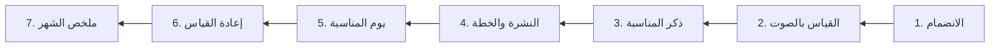
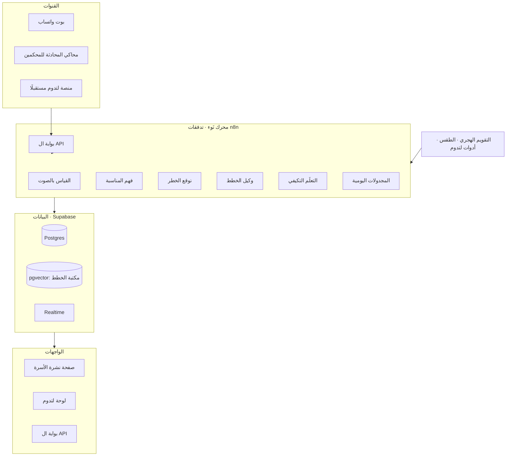

# نَوء — وثيقة الفكرة والبناء الشاملة (النسخة النهائية)

> **لتدوم تعرف وش تقول للأسرة، ونَوء يعرف متى تقوله.**
>
> فريق إنجاز · التحدي 01: من القياس إلى التغيير · الجهة صاحبة التحدي: لتدوم (الهيئة العامة للأمن الغذائي) · المسار الأول: الابتكار التقني والرقمي · هاكاثون الفقد والهدر الغذائي، 22–23 أكتوبر 2026

---

## 0. المشروع في صفحة

| العنصر | الخلاصة |
|---|---|
| المشكلة | لتدوم عندها أدوات للأسر (قياس، وحاسبة كميات، وطلب جمعية، ومحتوى توعوي)، لكن الاستخدام والتفاعل محدودان، فالأدوات ما تتحول إلى تغيير في السلوك |
| الجذر | النصيحة تصل في الوقت الخطأ، والقياس متعب وبلا هدف، والمنصة تنتظر المستخدم أن يتذكرها |
| الاكتشاف | هدر البيت له **مواسم**: العزائم، ورمضان والعيدين، والسفر، والتسوق الكبير بعد الراتب، وموجات الحر، وبداية الدراسة |
| الحل | **نَوء**: محرك ذكاء اصطناعي يتوقع أيام الخطر لكل أسرة، ويوصل لها أداة لتدوم المناسبة قبل الذروة بيومين، ثم يطلب إعادة القياس بعدها ويقارن |
| القناة | واتساب للأسرة (بلا تطبيق جديد)، و ال API لربط المحرك بمنصة لتدوم وأي قناة أخرى |
| ما تكسبه لتدوم | لوحة تحكم بمؤشرات التحدي الثلاثة، وخريطة الأسابيع الحرجة لتوقيت الحملات، وزيادة استخدام أدواتها الموجودة |
| الذكاء الاصطناعي | ثلاثة قرارات: **متى نرسل** (توقع الخطر)، و**وش نرسل** (وكيل خطط مقيّد بمكتبة لتدوم)، و**وش تعلمنا** (تعلم تكيفي من النتائج)، ومعها قياس بالصوت وفهم المناسبة من الكلام |
| ما نبنيه فعليًا | المحرك، وبوت واتساب (ونسخته على الويب للتجربة مع زر «قدّم الوقت»)، ولوحة لتدوم، وصفحة نشرة الأسرة، وبوابة ال API، على قاعدة بيانات Supabase واحدة وتدفقات n8n، مع بيانات تجريبية |
| ما نعرضه كتصميم فقط | شاشة واحدة: نَوء داخل تطبيق لتدوم (خطوة مستقبلية) |
| المشغّل | **لتدوم** هي المالك والمشغّل، والفريق شريك تقني يطوّر المحرك ويشغّله |
| التجربة الأولى | رمضان 1448 مع 100 إلى 200 أسرة من مستخدمي لتدوم، بمجموعة ضابطة |

### القرارات النهائية

1. **فكرة واحدة تحل مشكلة واحدة:** النصيحة تصل قبل مواسم الهدر، والقياس بعدها. وكل مكون له وظيفة واحدة في نفس الدورة (القسم 7.1).
2. **قاعدة بيانات واحدة، والمحرك وحده يكتب فيها:** البوت يكلّم المحرك، والنشرة واللوحة تقرآن فقط (القسم 7.2).
3. **ما نبنيه فعليًا ويُجرَّب:** المحرك، والبوت ونسخته على الويب، ولوحة لتدوم، وصفحة النشرة، وبوابة ال API (القسم 10).
4. **ما نعرضه كتصميم في الشرائح:** شاشة واحدة فقط، «نَوء داخل تطبيق لتدوم» (القسم 10.6).
5. **لا موقع تعريفي:** ألغيناه، ورمز QR يفتح نسخة المحادثة على الويب مباشرة.
6. **لتدوم المشغّل:** ونحتاج منها أربعة أشياء للتجربة (القسم 17)، وطلبنا في العرض واحد (القسم 18).

---

## 1. التحدي ومعايير التحكيم

### 1.1 التحدي كما طرحته لتدوم (من دليل المشارك)

- **المشكلة:** توفر منصة لتدوم أدوات وخدمات رقمية لدعم الأفراد والأسر في قياس الهدر الغذائي وتحسين ممارساتهم، إلا أن محدودية الاستخدام والتفاعل تقلل الاستفادة منها.
- **دورة التفاعل الرقمي:** القياس ← التوصيات ← التطبيق ← إعادة القياس. الهدف: تغيير السلوك وتقليل الهدر.
- **البيانات المتاحة:** بيانات الاستخدام، والزيارات، والتفاعل، والأدوات والمحتوى التوعوي المتاح (مجمعة أو مجهولة الهوية).
- **النتيجة المستهدفة:** نموذج أولي يعزز استخدام أدوات لتدوم والتفاعل معها، ويحفز تطبيق التوصيات والاستفادة المستمرة من المنصة.
- **نطاق التجربة:** خلال الهاكاثون نموذج ببيانات تجريبية، ولاحقًا تجربة فعلية باتفاق مستقل، على عينة من مستخدمي لتدوم.
- **القيود:** الاستفادة من أدوات لتدوم، وحماية الخصوصية، وقابلية الدمج مستقبلًا، وتوصيات بسيطة، وعدم جمع بيانات غير ضرورية.
- **مؤشرات النجاح:** انخفاض الهدر بين القياس الأول واللاحق، وارتفاع تطبيق التوصيات، وزيادة إعادة القياس.

### 1.2 معايير التحكيم (من قالب العرض الرسمي)

| المعيار | الوزن | الشرائح المرتبطة |
|---|---|---|
| الأثر في تقليل الفقد والهدر | 25% | المشكلة التي نعالجها، والأثر المتوقع وكيف نقيسه |
| قابلية التطبيق والجدوى | 25% | أول تطبيق على أرض الواقع، ورحلة الحل |
| الابتكار والتميز | 20% | فكرتنا وما يميزها |
| الاستدامة وقابلية التوسع | 15% | الاستدامة والتوسع |
| جودة النموذج الأولي والتنفيذ | 10% | ما أنجزناه في الهاكاثون |
| جودة العرض والتواصل | 5% | العرض كله والمناقشة |

**شروط التسليم:** ثماني شرائح بعناوين القالب وترتيبه، وعرض 5 دقائق ونقاش 3 دقائق، وقائد الفريق يرفع نسخة PDF وروابط النموذج الأولي **قبل الجمعة 23 أكتوبر الساعة 5:00 م**، والعروض تبدأ 5:15 م.

> **الخلاصة:** 90% من الدرجة على محتوى العرض، و10% على النموذج الأولي. نبني نموذجًا مبهرًا ومركّزًا، ونعطي الشرائح وقتها الكامل.

---

## 2. المشكلة وجذورها

### 2.1 بالأرقام

| الرقم | المعنى | المصدر |
|---|---|---|
| 27.9% | نسبة الفقد والهدر الغذائي في المملكة | مؤشر لتدوم 2024–2025 |
| 48% → 60% | حصة المنازل من الهدر، وترتفع في الأعياد والزواجات والعزائم | صحيفة الاقتصادية، 2026 |
| +40 مليار ريال | قيمة الغذاء المهدر سنويًا | صحيفة الاقتصادية، 2026 |
| رمضان، الحج، المواسم الدراسية | مواسم يرتفع فيها الهدر حسب تقرير الهيئة | صحيفة الوطن، فبراير 2026 |
| +100 تنزيل | عدد تنزيلات تطبيق لتدوم على أندرويد (اطلاع أكتوبر 2026، أندرويد فقط) | متجر Google Play |
| 50% | مستهدف خفض الهدر الوطني بحلول 2030 | مؤشر لتدوم |

### 2.2 ليش الأسر ما تستخدم الأدوات؟ (خمسة جذور)

1. **القياس متعب:** وزن وتعبئة نماذج، فيموت بعد أول مرة.
2. **القياس بلا هدف:** النتيجة رقم وبس، وإعادة القياس ما لها سبب واضح.
3. **التوصية في الوقت الخطأ:** عامة، وتصل بعد ما يصير الهدر أو في يوم عادي ما يحتاجها أحد.
4. **المنصة تنتظر المستخدم:** لازم يتذكرها ويفتحها بنفسه، وما يجيه شي في القناة اللي يستخدمها كل يوم.
5. **ما يشوف تقدمه:** ما فيه دليل إن تعبه أثّر.

### 2.3 الاكتشاف: الهدر له مواسم

هدر البيت ما يتوزع بالتساوي على أيام السنة. يرتفع في نوافذ محددة يمكن توقعها:

| المحفّز | ليش يرفع الهدر | من وين نعرفه |
|---|---|---|
| عزيمة أو مناسبة | طبخ زيادة للضيوف، وبواقي كبيرة | الأسرة تذكرها في المحادثة |
| رمضان والعيدين | تغير نمط الأكل، وكثرة الولائم | التقويم الهجري |
| السفر | أكل طازج يخرب والبيت فاضي | الأسرة تذكره |
| التسوق الكبير بعد الراتب | مشتريات أكثر من الاستهلاك، والخضار تتلف بعد أسبوع | تاريخ الراتب (27 من كل شهر) |
| موجة حر | الأكل يخرب أسرع | واجهة طقس مفتوحة |
| بداية الدراسة أو نهايتها | تغير مواعيد الوجبات | التقويم الدراسي |

> **التحول في الفكرة:** من «تذكير في موعد ثابت» إلى «تنبؤ بنافذة الخطر لكل أسرة بعينها».

---

## 3. الفكرة: نَوء

### 3.1 التعريف

**نَوء محرك توقيت ذكي يشغّل أدوات لتدوم الموجودة.** ما ينافس المنصة، يوصّل الأسرة لأداة لتدوم الصح في اللحظة الصح، ويحوّل دورة التحدي إلى دورة لها توقيت:


### 3.2 كيف يعالج كل جذر

| الجذر | علاج نَوء |
|---|---|
| القياس متعب | صوتية 15 ثانية بلهجة الأسرة تتحول إلى أصناف وكميات وأسباب، وتُحفظ في سجل لتدوم |
| القياس بلا هدف | إعادة القياس تصير ختام تجربة صغيرة: «الخطة نفعت أو لا؟» مع مقارنة بآخر مناسبة مشابهة |
| التوصية في الوقت الخطأ | النشرة تتوقع الخطر، والخطة تصل قبل الذروة بيومين، مبنية على محتوى لتدوم |
| المنصة تنتظر المستخدم | التنبيه يصل على واتساب، بموافقة الأسرة، وبحد أقصى رسالتين مبادرتين في الأسبوع |
| ما يشوف تقدمه | ملخص شهري بالكيلو والريال، ونتيجة كل موسم |

### 3.3 أدوات لتدوم داخل رحلة نَوء

| اللحظة | أداة لتدوم التي يوصلها نَوء |
|---|---|
| قبل العزيمة بيومين | حاسبة الكميات |
| بعد المناسبة إذا فيه أكل سليم ما انقدّم للضيوف | طلب جمعية خيرية (من تطبيق لتدوم) |
| بعد كل مناسبة | أداة القياس |
| ضمن الخطة | المحتوى التوعوي لتدوم (مكتبة الخطط مبنية منه) |

### 3.4 وجه التميز في سطر

**أول نظام يتنبأ بنافذة هدر كل أسرة ويتدخل قبلها، ثم يقيس أثره بعدها، ويتعلم ما ينفع مع كل بيت.**

---

## 4. رحلة الأسرة خطوة بخطوة



| الخطوة | ماذا يحدث | مثال الرسالة |
|---|---|---|
| 1. الانضمام | الأسرة تمسح رمز QR من موقع لتدوم أو تضغط رابطًا، فتفتح محادثة واتساب. سؤالان فقط: عدد أفراد البيت والمدينة، وموافقة صريحة على الرسائل | «مرحبًا بك في نشرة لتدوم لبيتك. كم عددكم في البيت؟» |
| 2. القياس بالصوت | صوتية قصيرة تتحول إلى أصناف وكميات وأسباب، مع زر تأكيد أو تعديل | «سجّلت 3 أصناف: رز مطبوخ 600 جم (طبخ زيادة)، خبز 300 جم (يبس)، خس 150 جم (خرب بالثلاجة). صح؟» |
| 3. ذكر المناسبة | جملة عادية، والمحرك يفهم النوع والتاريخ والعدد | «الخميس عندنا عزيمة 14 نفر» ← «سجّلت: عزيمة · الخميس 29 أكتوبر · 14 شخص» |
| 4. النشرة والخطة | قبل الذروة بيومين: مستوى الخطر وسببه، وخطة من 3 خطوات، ورابط حاسبة الكميات | «الخميس خطره مرتفع. 3 خطوات تكفي…» مع أزرار: بطبقها / ذكّرني بكرة / ما تناسبنا |
| 5. يوم المناسبة | تذكير قصير بالخطوة الأهم | «تذكير: جهزوا علب البواقي قبل العشاء» |
| 6. إعادة القياس | بعد المناسبة: «طبقتوا الخطة؟» ثم صوتية بالي انرمى، والنتيجة مقارنة بآخر مناسبة مشابهة. إذا فيه أكل سليم ما انقدّم: رابط طلب جمعية | «هدر العزيمة 0.9 كجم، عزيمتكم الماضية 2.4 كجم: أقل 62%» |
| 7. ملخص الشهر | رابط صفحة ملخص: الكيلو والريال، والمواسم، والخطط المطبقة | «ملخص أكتوبر: 6.8 كجم، أقل 31% من سبتمبر» |

**جهد الأسرة:** دقيقتان للانضمام، ثم دقائق قليلة في الشهر. لا إدخال يومي.

---

## 5. ماذا تكسب لتدوم

1. **مؤشرات التحدي الثلاثة حيّة في لوحة واحدة:** انخفاض الهدر بين القياس الأول واللاحق، ونسبة تطبيق التوصيات، ومعدل إعادة القياس.
2. **زيادة استخدام أدواتها الموجودة:** كل نقرة على حاسبة الكميات أو طلب الجمعية أو أداة القياس تُسجّل وتظهر في اللوحة.
3. **خريطة الأسابيع الحرجة:** أسابيع السنة الهجرية التي يتوقع فيها ارتفاع الهدر حسب المنطقة ونوع المحفّز، لتعرف لتدوم **متى تطلق حملتها ولأي فئة**.
4. **بيانات سلوكية مفصلة ومجهّلة:** الهدر حسب الصنف والسبب والموسم، وهي بيانات لا يعطيها المسح الوطني بهذا التفصيل الزمني.
5. **محرك قابل للدمج:** ال API نفسه يمكن أن تستدعيه منصة لتدوم أو تطبيقها، وواتساب مجرد أول قناة.

---

## 6. الالتزام بقيود التحدي

| القيد | كيف يلتزم نَوء |
|---|---|
| الاستفادة من أدوات لتدوم | القياس يُحفظ في سجل لتدوم، والخطط من محتواها، والنشرة باسمها، والروابط تقود لحاسبة الكميات وطلب الجمعية وأداة القياس |
| حماية الخصوصية | لا أسماء ولا صور ولا تتبع موقع. رقم الجوال يُخزن مشفّرًا (Hash)، والصوتية تُحذف بعد تحويلها لنص، وكلمة «إيقاف» توقف كل شيء وتحذف البيانات عند الطلب |
| عدم جمع بيانات غير ضرورية | الحقول: عدد أفراد البيت، والمدينة، والقياسات، والمناسبات التي تذكرها الأسرة. فقط |
| توصيات بسيطة | ثلاث خطوات كحد أقصى في كل خطة، كل خطوة سطر واحد |
| قابلية الدمج مستقبلًا | ال API موثق بمعيار OpenAPI، وكل وظيفة في المحرك نقطة مستقلة |
| التجربة اللاحقة باتفاق مستقل | خطة التجربة جاهزة (القسم 17)، والطلب الوحيد من لتدوم محدد |

---

## 7. معمارية النظام

### 7.1 فكرة واحدة، وكل مكون بوظيفة واحدة

| المكون | وظيفته في الدورة | من يستخدمه |
|---|---|---|
| **المحرك** | العقل: يفهم القياس، ويتوقع الخطر، ويختار الخطة، ويتعلم | يشغّل كل المكونات |
| **بوت واتساب** | يوصل للأسرة: القياس، والخطة، والتذكير، وإعادة القياس | الأسرة |
| **صفحة النشرة** | توري الأسرة أسبوعها: متى الخطر وليش | الأسرة |
| **لوحة لتدوم** | توري لتدوم الأثر والمؤشرات، ومتى تطلق حملاتها | فريق لتدوم |
| **بوابة ال API** | تثبت أن المحرك يرتبط بتطبيق لتدوم أو أي قناة | لتدوم والمطورون |

نسخة المحادثة على الويب ليست مكونًا مستقلًا: هي البوت نفسه في المتصفح، للتجربة فقط.

**الجملة في العرض:** «كل مكون في نَوء يخدم خطوة واحدة من دورة لتدوم: القياس، والتوصية، والتطبيق، وإعادة القياس.»

### 7.2 كيف ترتبط المكونات: قاعدة بيانات واحدة

**القاعدة الذهبية: المحرك وحده يكتب في قاعدة البيانات. الباقي يكلّم المحرك أو يقرأ فقط.**

| المكون | علاقته بالقاعدة |
|---|---|
| بوت واتساب ونسخته على الويب | يرسل الرسالة للمحرك، والمحرك يحلل ويحفظ ويرجع الرد. لا يلمس القاعدة مباشرة |
| صفحة النشرة | قراءة فقط: توقعات الأسرة وقياساتها |
| لوحة لتدوم | قراءة فقط، من عروض مجمّعة (Views) بلا أي بيانات لأسرة بعينها |
| بوابة ال API | أي جهة خارجية تكلّم المحرك، مثل البوت تمامًا |

**مثال: رحلة صوتية واحدة داخل النظام**

1. الأسرة ترسل صوتية في **البوت**.
2. **المحرك** يحولها إلى أصناف ويكتبها في **القياسات**.
3. يعيد حساب أسبوع الأسرة ويحدّث **التوقعات**.
4. **صفحة النشرة** تقرأ التوقعات الجديدة، فيتغير لون اليوم.
5. **لوحة لتدوم** تلتقط القياس من العروض، فيظهر في البث الحي والمؤشرات.
6. قبل المناسبة بيومين، **المحرك** يختار خطة من **المكتبة**، ويكتبها في **الخطط المرسلة**، و**البوت** يرسلها.
7. بعد المناسبة، **المحرك** يسجّل التطبيق والقياس الجديد في **النتائج**، ويحدّث **التعلّم**، و**اللوحة** ترفع مؤشراتها.

**في الخصوصية:** لتدوم تشوف أرقامًا مجمّعة فقط، والأسرة تشوف بياناتها فقط.

### 7.3 المعمارية



| الطبقة | التقنية |
|---|---|
| القنوات | WhatsApp Cloud API (رقم اختبار)، ونسخة المحادثة على الويب بنفس المحرك |
| المحرك | n8n: كل وظيفة تدفق مستقل، ونقاط ال API عبر عقد Webhook |
| الذكاء الاصطناعي | تحويل الصوت لنص (Whisper)، ونموذج لغوي بمخرجات JSON مقيدة، وتضمينات نصية للبحث في مكتبة الخطط |
| البيانات | Supabase: Postgres، و pgvector، و Realtime للبث الحي في اللوحة، و Storage مؤقت للصوتيات |
| الواجهات | React (Vite) مع Tailwind، ومكتبة رسوم (ECharts أو Recharts)، ونشر على Vercel أو Netlify |
| التوثيق | ملف OpenAPI يعرض بـ Redoc أو Swagger UI |
| مصادر خارجية | تحويل التاريخ الهجري، وواجهة طقس مفتوحة (Open-Meteo)، وروابط أدوات لتدوم |

---

## 8. المحرك

### 8.1 مبادئ المحرك

- **محرك واحد، قنوات كثيرة:** البوت ونسخته على الويب ولوحة لتدوم كلها تستدعي نفس النقاط.
- **كل قرار له سبب مكتوب:** أي توقع أو خطة يرجع معه سبب بلغة بسيطة («آخر 3 عزائم كانت 58% من هدر شهركم»).
- **لا نصيحة من خارج المكتبة:** النموذج اللغوي يختار ويصيغ، وما يخترع.
- **الخصوصية افتراضيًا:** المعرّف الداخلي للأسرة رقم عشوائي، وما يمر رقم الجوال لأي نموذج لغوي.

### 8.2 نقاط ال API

| الطريقة والمسار | الوظيفة |
|---|---|
| `POST /v1/households` | تسجيل أسرة: عدد الأفراد، والمدينة، والموافقة، والقناة |
| `POST /v1/measurements/voice` | رابط صوتية ← نص ← أصناف وكميات وأسباب |
| `POST /v1/measurements` | قياس منظم (من أداة لتدوم أو من إدخال يدوي) |
| `POST /v1/events/parse` | جملة ← مناسبة (النوع، والتاريخ، والعدد، والمدة) |
| `GET /v1/households/{id}/forecast` | نشرة 7 أيام: مستوى الخطر لكل يوم، والسبب، والأصناف المعرضة |
| `POST /v1/plans/generate` | خطة من 3 خطوات لمناسبة أو يوم خطر، مع روابط أدوات لتدوم |
| `POST /v1/plans/{id}/adherence` | تطبيق الخطة: طبقتها، أو جزئيًا، أو لا |
| `POST /v1/outcomes` | قياس ما بعد المناسبة ← مقارنة بالسابق ← تحديث التعلم |
| `GET /v1/households/{id}/summary` | الملخص الشهري |
| `GET /v1/insights/kpis` | مؤشرات لتدوم الثلاثة، والاستخدام، والتفاعل |
| `GET /v1/insights/critical-weeks` | خريطة الأسابيع الحرجة حسب المنطقة والمحفّز |
| `GET /v1/insights/live` | آخر القياسات المجهّلة للبث الحي |
| `POST /v1/channels/whatsapp/inbound` | استقبال رسائل واتساب وتوجيهها |
| `POST /v1/channels/web/inbound` | استقبال رسائل نسخة المحادثة على الويب |
| `POST /v1/demo/advance-time` | للعرض فقط: تقديم الوقت يومين أو أسبوع لأسرة تجريبية، وتشغيل المجدولات فورًا |

**مثال: توقع الأسبوع**

```json
GET /v1/households/h_4821/forecast?from=2026-10-25

{
  "household_id": "h_4821",
  "days": [
    {"date": "2026-10-29", "level": "high", "expected_kg": 2.1,
     "drivers": ["gathering"], "reason_ar": "عزيمة 14 شخص. آخر 3 عزائم = 58% من هدر شهركم",
     "items_at_risk": ["رز مطبوخ", "خبز"]},
    {"date": "2026-10-31", "level": "high", "expected_kg": 1.4,
     "drivers": ["travel_before"], "reason_ar": "سفر 4 أيام: الحليب والخبز والورقيات بتخرب",
     "items_at_risk": ["حليب", "خبز", "خضار ورقية"]}
  ],
  "model_version": "risk-v1"
}
```

**مثال: الخطة**

```json
POST /v1/plans/generate
{"household_id": "h_4821", "event_id": "ev_77"}

{
  "plan_id": "pl_301",
  "send_at": "2026-10-27T20:30:00+03:00",
  "steps": [
    {"step_id": "G-PRE-02", "phase": "before", "text_ar": "الأربعاء: فضّوا رف بالثلاجة وجهّزوا علب للبواقي"},
    {"step_id": "G-DUR-01", "phase": "during", "text_ar": "بعد العشاء: الباقي يدخل الثلاجة بسرعة، والرز يتقسّم ويتجمّد"},
    {"step_id": "G-AFT-03", "phase": "after", "text_ar": "الجمعة: غداكم من بواقي العزيمة بدل طبخ جديد"}
  ],
  "litadoom_tools": [{"tool": "quantity_calculator", "url": "{رابط حاسبة الكميات}"}],
  "source": "plan_library_v1"
}
```

### 8.3 القرار الأول: متى نرسل؟ (نموذج توقع الخطر)

**الفكرة:** لكل أسرة معدل هدر يومي أساسي، وكل محفّز يضربه في معامل. المعاملات تبدأ من قيمة عامة لكل المجتمع، وتتخصص للأسرة كلما قاست أكثر (تجميع جزئي هرمي).

**المعادلات:**

```math
(1)  E[h,d] = b[h] * PRODUCT over k of  m[h,k] ^ x[d,k]

(2)  m[h,k] = ( n[h,k] * r[h,k]  +  K * m[k] ) / ( n[h,k] + K ),   K = 3

(3)  b[h]   = ( a0 + sum of waste on normal days ) / ( b0 + number of normal days measured )

(4)  ratio  = E[h,d] / b[h]
```

| الرمز | المعنى |
|---|---|
| `E[h,d]` | الهدر المتوقع للأسرة h في اليوم d (كجم) |
| `b[h]` | معدل الهدر اليومي الأساسي للأسرة في الأيام العادية، ويُحدَّث بطريقة Gamma–Poisson (المعادلة 3) |
| `x[d,k]` | يساوي 1 إذا المحفّز k نشط في اليوم d، وإلا 0 |
| `m[h,k]` | معامل المحفّز k لهذه الأسرة بعد التخصيص (المعادلة 2) |
| `m[k]` | المعامل العام للمحفّز على مستوى كل الأسر |
| `r[h,k]` | متوسط النسبة المرصودة للأسرة: هدر يوم المحفّز ÷ `b[h]` |
| `n[h,k]` | عدد مرات رصد المحفّز عند الأسرة |
| `K` | قوة الانكماش نحو المتوسط العام: الأسرة الجديدة تتبع المعامل العام، وكلما قاست أكثر تتخصص |

| النسبة `ratio` | مستوى الخطر |
|---|---|
| أقل من 1.3 | منخفض |
| من 1.3 إلى أقل من 2 | متوسط |
| 2 فأكثر | مرتفع |

**المعاملات العامة الأولية** (تُعدّل من البيانات، وتُعرض في العرض كقيم أولية):

| المحفّز | الرمز | المعامل الأولي | متى ينشط |
|---|---|---|---|
| عزيمة | `gathering` | 2.8 | يوم المناسبة واليوم التالي (×1.5) |
| رمضان | `ramadan` | 1.6 | طوال الشهر |
| العيد | `eid` | 2.2 | أول 3 أيام |
| قبل السفر | `travel_before` | 2.0 | آخر يومين قبل السفر |
| بعد التسوق الكبير | `post_shopping` | 1.5 | اليوم 5 إلى 9 بعد الراتب |
| موجة حر | `heatwave` | 1.3 | الحرارة العظمى ≥ 45 درجة |
| بداية الدراسة | `school_start` | 1.3 | أول أسبوع |

**السبب المكتوب:** المحرك يختار المحفّز الأعلى أثرًا، ويكتب السبب من بيانات الأسرة نفسها عند توفرها («آخر 3 عزائم = 58% من هدر شهركم»)، وإلا من القيمة العامة.

**الأصناف المعرضة:** حصة كل صنف من هدر الأسرة × ميل الصنف للمحفّز (مثال: السفر يرفع الحليب والخبز والورقيات، والعزيمة ترفع الرز المطبوخ واللحوم).

### 8.4 القرار الثاني: وش نرسل؟ (وكيل الخطط)

1. **الاسترجاع:** بحث في مكتبة الخطط (pgvector) بفلترة على نوع المحفّز والأصناف المعرضة، ويرجع 8 إلى 12 خطوة مرشحة.
2. **الاختيار:** التعلم التكيفي (القسم 8.5) يرتب المرشحات، ويختار 3 خطوات من مراحل مختلفة (قبل، وأثناء، وبعد).
3. **الصياغة:** نموذج لغوي يعيد كتابة الخطوات بلهجة الأسرة وبأسماء الأيام الفعلية، بمخرجات JSON مقيدة تحتوي **معرّفات الخطوات فقط من المكتبة**.
4. **الحارس:** تحقق آلي: كل `step_id` موجود في المكتبة، والنص لا يضيف معلومة غذائية أو صحية جديدة، وطول كل خطوة سطر واحد. إذا فشل التحقق تُرسل الصياغة الأصلية من المكتبة.

**تعليمات النظام المختصرة للوكيل:**

```text
أنت محرر رسائل لنشرة لتدوم. تستلم خطوات من مكتبة معتمدة.
- لا تضف أي نصيحة أو معلومة غير موجودة في الخطوات.
- أعد كتابة كل خطوة بسطر واحد باللهجة السعودية البيضاء، واستخدم اسم اليوم الفعلي.
- أرجع JSON فقط: {"steps":[{"step_id":"...","text_ar":"..."}]}
```

### 8.5 القرار الثالث: وش تعلمنا؟ (التعلم التكيفي)

- لكل أسرة ولكل خطوة توزيع Beta(α, β) يمثل احتمال نجاحها مع هذه الأسرة.
- البداية من نجاح الخطوة على مستوى كل الأسر (α0 و β0 من البيانات العامة).
- عند اختيار الخطة: سحب عينة من كل توزيع (Thompson Sampling)، واختيار الأعلى من كل مرحلة.
- **المكافأة بعد المناسبة:**
    - طبقتها + هدر أقل من 80% من المتوقع ← نجاح كامل: α + 1
    - جزئيًا، أو طبقتها والهدر لم ينخفض ← نصف نجاح: α + 0.5 و β + 0.5
    - لم تُطبّق ← β + 1
- النتيجة في الرسالة: «أكثر خطوة نفعت معكم: علب البواقي. بنقدّمها أول في عزائمكم الجاية.»

### 8.6 القياس بالصوت

1. واتساب يرسل معرّف الصوتية، والتدفق يحملها مؤقتًا.
2. تحويل الصوت لنص بالعربية (Whisper).
3. نموذج لغوي يستخرج الأصناف بمخطط JSON ثابت (المثال أدناه).
4. **قاموس الوحدات الشعبية** في قاعدة البيانات يحول «نص قدر» و«صحن» و«ربطة» و«حبة» إلى جرامات تقديرية، والنموذج يستخدمه بدل التخمين.
5. **الأسباب الموحدة:** طبخ زيادة، يبس أو خرب، انتهت الصلاحية، بواقي صحون، نسيان بالثلاجة، تسوق زيادة، أخرى.
6. رد بزر «صح» أو «عدّل»، ثم حذف الصوتية.

**مثال مخرجات الاستخراج:**

```json
{"items":[
  {"item_ar":"رز مطبوخ","category":"grains_cooked","qty_text":"نص قدر","grams":600,
   "reason":"overcooked","confidence":0.8}
]}
```

### 8.7 فهم المناسبة من الكلام

- نموذج لغوي يحدد: النوع (`gathering` أو `travel` أو `ramadan_iftar` أو `eid` أو `other`)، والتاريخ (يحوّل «الخميس الجاي» و«بعد العيد» إلى تاريخ ميلادي وهجري)، والعدد، والمدة.
- إذا نقص التاريخ يسأل سؤالًا واحدًا فقط.
- التأكيد يرجع للأسرة ببطاقة واضحة مع زر «تمام» أو «عدّل».

### 8.8 سياسة الإرسال

| القاعدة | القيمة |
|---|---|
| الحد الأقصى للرسائل المبادرة | رسالتان في الأسبوع |
| موعد الخطة | قبل الذروة بـ 48 ساعة، الساعة 8:30 م |
| تذكير يوم المناسبة | مرة واحدة، قبل الموعد بـ 4 ساعات |
| سؤال ما بعد المناسبة | اليوم التالي الساعة 1 م |
| ساعات الهدوء | من 11 م إلى 8 ص |
| الخطر المتوسط | يظهر في النشرة الأسبوعية فقط، بدون رسالة مستقلة |
| الإيقاف | كلمة «إيقاف» توقف كل الرسائل فورًا |

---

## 9. بوت واتساب

### 9.1 حالات المحادثة

| الحالة | المدخل | ما يفعله البوت |
|---|---|---|
| انضمام | أول رسالة أو رابط QR | ترحيب باسم لتدوم، وسؤالا عدد الأفراد والمدينة، وموافقة |
| قياس صوتي | رسالة صوتية | استخراج الأصناف، وبطاقة تأكيد بزرين |
| قياس نصي | «رمينا…» | نفس المسار بدون تحويل الصوت |
| مناسبة | جملة فيها موعد أو ضيوف أو سفر | بطاقة مناسبة وتأكيد |
| خطة | مجدول | رسالة الخطة مع 3 أزرار تفاعلية |
| تذكير | مجدول | سطر واحد بالخطوة الأهم |
| ما بعد المناسبة | مجدول | سؤال التطبيق بأزرار، ثم طلب صوتية |
| النتيجة | بعد القياس | بطاقة مقارنة، وأفضل خطوة، ورابط طلب الجمعية إذا يلزم |
| نشرة | كلمة «نشرة» أو مجدول أسبوعي | رابط صفحة نشرة الأسرة |
| مساعدة | «مساعدة» | قائمة الأوامر |
| إيقاف | «إيقاف» | تأكيد الإيقاف |

### 9.2 الرسائل التفاعلية

- **أزرار الرد السريع** (3 كحد أقصى): صح / عدّل، تمام / عدّل، بطبقها / ذكّرني بكرة / ما تناسبنا، طبقتها / جزئيًا / لا.
- **قوالب رسائل معتمدة** للرسائل خارج نافذة 24 ساعة: `nawa_plan_v1`، `nawa_reminder_v1`، `nawa_followup_v1`، `nawa_weekly_v1`، `nawa_monthly_v1`.

### 9.3 ملاحظات تشغيلية للهاكاثون

- رقم الاختبار في WhatsApp Cloud API يرسل لأرقام مسجلة محدودة فقط، فالتجربة الحية للمحكمين تكون من **محاكي المحادثة** على الموقع، والبوت يُعرض من جوال الفريق.
- الرد على أي رسالة خلال 3 ثوانٍ («لحظة، أسمع صوتيتك…») ثم النتيجة، حتى ما يبان بطء التحويل.

---

## 10. الواجهات: ما نبنيه فعليًا وما نعرضه كتصميم

| الواجهة | الحالة | التقنية |
|---|---|---|
| نسخة المحادثة على الويب + زر «قدّم الوقت» | **نبنيها، ويجربها المحكم** | React، والتسجيل الصوتي بال MediaRecorder، وتكلّم المحرك |
| لوحة لتدوم | **نبنيها** | React، ومكتبة رسوم (ECharts أو Recharts)، و Supabase Realtime |
| صفحة نشرة الأسرة | **نبنيها** | React، وتقرأ من Supabase |
| بوابة ال API | **نبنيها** | Swagger UI من ملف `openapi.yaml` |
| نَوء داخل تطبيق لتدوم | **تصميم في الشرائح فقط** | شاشة جوال |
| الموقع التعريفي | **ملغى** | — |

### 10.1 نسخة المحادثة على الويب (أهم شيء يجربه المحكم)

- شاشة بشكل واتساب في المتصفح، تستدعي نفس المحرك عبر `/v1/channels/web/inbound`. ليست منتجًا مستقلًا، بل البوت نفسه للتجربة.
- رمز QR على شريحة «ما أنجزناه» يفتحها مباشرة.
- تسجيل صوتي من المتصفح، ورسائل جاهزة بنقرة («جرّب: الخميس عندنا عزيمة 14 نفر»).
- **زر «قدّم الوقت»:** يقفز يومين أو أسبوعًا عبر `/v1/demo/advance-time`، فيرى المحكم الدورة كاملة في دقيقة:
  1. يكتب المناسبة، فيتحول اليوم للأحمر في النشرة.
  2. يضغط «قدّم يومين»، فتصله الخطة بأزرارها.
  3. يضغط «بعد المناسبة»، فيُسأل «طبقتوها؟» ويرسل صوتية.
  4. تصله بطاقة النتيجة («أقل 62%»)، ويظهر القياس في البث الحي على لوحة لتدوم.

### 10.2 لوحة لتدوم (أقوى شاشة في العرض)

**نبني فعليًا أربعة عناصر:**

| العنصر | الوصف |
|---|---|
| بطاقات المؤشرات الثلاثة | انخفاض الهدر بين القياس الأول واللاحق، ونسبة تطبيق التوصيات، ومعدل إعادة القياس، ومعها الأسر النشطة وعدد القياسات |
| **قمع الدورة** | القياس ← التوصية ← التطبيق ← إعادة القياس، بعدد الأسر ونسبة العبور في كل مرحلة |
| **خريطة الأسابيع الحرجة** | خريطة حرارية: الأسابيع الهجرية × المناطق، مع فلتر حسب المحفّز. تقول للتدوم متى تطلق حملتها ولأي منطقة (هذا هو «مخطِّط الحملات»، وليس شاشة مستقلة) |
| **البث الحي** | آخر القياسات المجهّلة تظهر لحظة وصولها (Supabase Realtime): «أسرة في بريدة · رز مطبوخ 600 جم · طبخ زيادة» |

**إضافات إذا بقي وقت:** قبل وبعد حسب الموسم، والهدر حسب الصنف والسبب، ونقرات أدوات لتدوم.

**في الشرائح بدل اللوحة:** رسم ثابت لمقارنة نَوء مع المجموعة الضابطة من البيانات التجريبية (شريحة الأثر).

### 10.3 صفحة نشرة الأسرة (رابط خاص لكل أسرة يصل من البوت)

- رأس فيه الأسبوع وعدد أفراد البيت.
- **شريط الأيام السبعة** بألوان الخطر (منخفض، متوسط، مرتفع).
- بطاقة لكل يوم خطر: السبب والأصناف المعرضة والخطة.
- «أكثر ما ينهدر عندكم» آخر 30 يومًا بأشرطة أفقية.
- الملخص الشهري (إذا بقي وقت، وإلا نستخدم شاشته من النموذج الأولي).

### 10.4 بوابة ال API

- صفحة Swagger UI من ملف `openapi.yaml`، وزر «جرّب» على كل نقطة.
- مفتاح تجريبي للعرض، ومثال جاهز لكل نقطة.
- تُذكر في العرض بجملة واحدة كدليل: «المحرك جاهز للربط مع تطبيق لتدوم».

### 10.5 ما نعرضه كتصميم فقط

**شاشة واحدة:** «نَوء داخل تطبيق لتدوم»، شاشة جوال لتطبيق لتدوم تظهر فيها النشرة عبر ال API. توضح أننا نكمّل لتدوم ولا ننافسها، وتوضع في شريحة الاستدامة والتوسع كخطوة قادمة.

---

## 11. قاعدة البيانات (Supabase)

### 11.1 الجداول

```sql
-- الأسرة: أقل بيانات ممكنة
create table households (
  id text primary key,                 -- معرّف عشوائي h_xxxx
  phone_hash text unique,              -- SHA-256 مع ملح، لا يُخزن الرقم
  channel text check (channel in ('whatsapp','web','litadoom')),
  size int check (size between 1 and 20),
  city text, region text,
  cohort text default 'nawa',          -- nawa أو control في التجربة
  consent_at timestamptz, stopped_at timestamptz,
  created_at timestamptz default now()
);

create table measurements (
  id bigserial primary key,
  household_id text references households(id),
  source text check (source in ('voice','text','litadoom_tool')),
  measured_on date not null,
  event_id bigint,                     -- إذا كان قياس ما بعد مناسبة
  total_g int,
  transcript text,                     -- النص فقط، الصوتية تُحذف
  created_at timestamptz default now()
);

create table measurement_items (
  id bigserial primary key,
  measurement_id bigint references measurements(id) on delete cascade,
  item_ar text, category text, grams int,
  reason text check (reason in ('overcooked','spoiled','expired','plate_leftover','forgotten','overbought','other')),
  confidence real
);

create table events (
  id bigserial primary key,
  household_id text references households(id),
  type text check (type in ('gathering','travel','ramadan_iftar','eid','other')),
  starts_on date, ends_on date, guests int,
  raw_text text, confirmed boolean default false,
  created_at timestamptz default now()
);

create table drivers_calendar (        -- محفّزات عامة: رمضان، العيد، الراتب، الدراسة
  day date, driver text, region text default 'all',
  primary key (day, driver, region)
);

create table weather_daily (
  day date, city text, tmax real,
  primary key (day, city)
);

create table forecasts (
  household_id text references households(id),
  day date, level text, expected_kg real, ratio real,
  drivers text[], reason_ar text, items_at_risk text[],
  model_version text, created_at timestamptz default now(),
  primary key (household_id, day)
);

create table driver_multipliers (      -- المعاملات العامة والخاصة
  scope text,                          -- 'global' أو household_id
  driver text, multiplier real, n_obs int default 0,
  primary key (scope, driver)
);

create table plan_library (
  step_id text primary key,            -- مثل G-PRE-02
  driver text, phase text check (phase in ('before','during','after')),
  text_ar text, items text[],
  litadoom_tool text,                  -- quantity_calculator / charity_request / measure / null
  source text,                         -- محتوى لتدوم أو إرشاد سلامة غذاء
  embedding vector(1536)
);

create table plans (
  id bigserial primary key,
  household_id text references households(id),
  event_id bigint references events(id),
  forecast_day date, send_at timestamptz, sent_at timestamptz,
  steps jsonb, created_at timestamptz default now()
);

create table adherence (
  plan_id bigint references plans(id),
  answer text check (answer in ('yes','partial','no')),
  answered_at timestamptz default now(),
  primary key (plan_id)
);

create table outcomes (
  plan_id bigint references plans(id) primary key,
  measurement_id bigint references measurements(id),
  expected_g int, actual_g int, prev_similar_g int,
  change_pct real, reward real
);

create table bandit_arms (
  household_id text, step_id text references plan_library(step_id),
  alpha real default 1, beta real default 1,
  primary key (household_id, step_id)
);

create table tool_clicks (             -- استخدام أدوات لتدوم
  id bigserial primary key,
  household_id text, tool text, plan_id bigint,
  clicked_at timestamptz default now()
);

create table messages_log (
  id bigserial primary key,
  household_id text, direction text, kind text, template text,
  created_at timestamptz default now()
);

create table food_units (              -- قاموس الوحدات الشعبية
  unit_ar text, category text, grams_est int,
  primary key (unit_ar, category)
);
```

### 11.2 العروض والدوال

| الاسم | ماذا يرجع |
|---|---|
| `v_kpis` | المؤشرات الثلاثة لكل فترة ومجموعة (نَوء أو ضابطة) |
| `v_funnel` | عدد الأسر في كل مرحلة من الدورة |
| `v_critical_weeks` | متوسط نسبة الخطر لكل أسبوع هجري ومنطقة ومحفّز |
| `v_waste_by_item_reason` | الهدر حسب الصنف والسبب |
| `fn_forecast(household_id, from_date)` | توقع 7 أيام بالمعادلة في القسم 8.3 |
| `fn_update_multipliers(household_id)` | إعادة حساب المعاملات الخاصة بعد كل قياس |
| `fn_match_steps(driver, items, k)` | بحث متجهي في مكتبة الخطط |

### 11.3 تعريف المؤشرات الثلاثة

| المؤشر | طريقة الحساب |
|---|---|
| انخفاض الهدر بين القياس الأول واللاحق | 1 − (هدر قياس ما بعد المناسبة ÷ هدر أول قياس لنفس نوع المناسبة)، لكل أسرة، ثم الوسيط |
| نسبة تطبيق التوصيات | (عدد إجابات «طبقتها» + نصف عدد «جزئيًا») ÷ عدد الخطط المرسلة |
| معدل إعادة القياس | عدد المناسبات التي تلاها قياس خلال 72 ساعة ÷ عدد المناسبات التي أُرسلت لها خطة |

### 11.4 الأمان

- تفعيل Row Level Security على كل الجداول، والوصول من الواجهات عبر العروض المجمّعة فقط.
- مفتاح الخدمة يبقى في n8n فقط، والواجهات تستخدم المفتاح العام مع العروض.
- لا يظهر أي معرّف أسرة في لوحة لتدوم، والبث الحي يعرض المدينة والصنف فقط.

---

## 12. تدفقات n8n

| التدفق | المشغّل | الخطوات |
|---|---|---|
| WF-01 الموجّه | Webhook واتساب أو نسخة الويب | تحقق التوقيع ← جلب الأسرة أو إنشاؤها ← تصنيف الرسالة (صوت، نص قياس، مناسبة، أمر، رد زر) ← تحويل للتدفق المناسب |
| WF-02 القياس بالصوت | من WF-01 | تحميل الصوت ← Whisper ← استخراج JSON ← قاموس الوحدات ← حفظ ← بطاقة تأكيد ← حذف الملف |
| WF-03 القياس النصي | من WF-01 | استخراج JSON ← حفظ ← تأكيد |
| WF-04 المناسبة | من WF-01 | استخراج النوع والتاريخ والعدد ← حفظ ← بطاقة تأكيد ← إعادة حساب التوقع |
| WF-05 التوقع اليومي | جدولة 6:00 ص | جلب الطقس ← تحديث المحفّزات ← `fn_forecast` لكل أسرة نشطة |
| WF-06 مرسل الخطط | جدولة 8:30 م | أيام خطر مرتفع بعد 48 ساعة ← فحص سياسة الإرسال ← `fn_match_steps` ← Thompson ← صياغة ← الحارس ← إرسال القالب |
| WF-07 تذكير اليوم | جدولة كل ساعة | المناسبات بعد 4 ساعات ← سطر الخطوة الأهم |
| WF-08 ما بعد المناسبة | جدولة 1:00 م | سؤال التطبيق بأزرار ← طلب صوتية |
| WF-09 النتيجة والتعلّم | بعد قياس مرتبط بمناسبة | المقارنة ← المكافأة ← تحديث `bandit_arms` و`driver_multipliers` ← بطاقة النتيجة ← رابط الجمعية إذا لزم |
| WF-10 النشرة والملخص | جدولة الخميس 7 م وآخر الشهر | رابط صفحة النشرة أو الملخص |
| WF-11 ال API العام | Webhooks `/v1/*` | التحقق من المفتاح ← تنفيذ الوظيفة ← JSON |
| WF-12 مولد البيانات التجريبية | يدوي | ينشئ الأسر والقياسات والمناسبات والخطط والنتائج (القسم 14) |
| WF-13 عارض الديمو | يدوي | يضخ قياسات مجهّلة كل بضع ثوانٍ للبث الحي أثناء العرض |
| WF-14 قدّم الوقت | Webhook `/v1/demo/advance-time` | يحرّك «تاريخ اليوم» للأسرة التجريبية ← يشغّل WF-05 ثم WF-06 أو WF-08 فورًا بدل انتظار الجدولة |

**إعدادات النموذج اللغوي:** حرارة منخفضة (0 إلى 0.3)، ومخرجات JSON بمخطط، وإعادة المحاولة مرة واحدة عند فشل التحقق، ثم مسار احتياطي بقواعد ثابتة.

---

## 13. مكتبة الخطط

### 13.1 بنية الخطوة

| الحقل | مثال |
|---|---|
| `step_id` | G-PRE-02 |
| المحفّز | عزيمة |
| المرحلة | قبل |
| النص | فضّوا رف بالثلاجة وجهّزوا علب للبواقي قبل العزيمة |
| الأصناف | رز مطبوخ، لحوم |
| أداة لتدوم | حاسبة الكميات |
| المصدر | محتوى لتدوم التوعوي، أو إرشاد سلامة غذاء معتمد |

### 13.2 أمثلة أولية (تُراجع من لتدوم قبل التجربة)

| المحفّز | المرحلة | الخطوة |
|---|---|---|
| عزيمة | قبل | احسبوا الكميات بحاسبة لتدوم قبل الشراء |
| عزيمة | قبل | فضّوا رف بالثلاجة وجهّزوا علب للبواقي |
| عزيمة | أثناء | قدّموا الأكل على دفعات بدل ما ينحط كله مرة وحدة |
| عزيمة | بعد | الباقي اللي ما انقدّم يبرد ويدخل الثلاجة بسرعة |
| عزيمة | بعد | غداكم بكرة من البواقي بدل طبخ جديد |
| عزيمة | بعد | الأكل السليم اللي ما انقدّم: اطلبوا جمعية من تطبيق لتدوم |
| سفر | قبل | خلصوا الحليب والورقيات قبل السفر بيومين، ولا تشترون جديد |
| سفر | قبل | جمّدوا الخبز واللحوم اللي ما بتنستهلك |
| بعد التسوق | قبل | رتّبوا الثلاجة: الأقدم قدّام والجديد ورا |
| بعد التسوق | أثناء | الخضار اللي قربت تذبل: شوربة أو طبخة اليوم |
| رمضان | قبل | خططوا فطور الأسبوع قبل التسوق |
| رمضان | بعد | بواقي الفطور تصير سحور |
| حر | أثناء | لا تخلون الأكل المطبوخ برا الثلاجة وقت الظهر |
| العيد | قبل | اتفقوا مع الأهل مين يجيب وش، عشان ما تتكرر الأطباق |

**قاعدة الصياغة:** سطر واحد، فعل واضح، يوم محدد، بلا أرقام صحية أو غذائية مخترعة.

---

## 14. البيانات التجريبية

| المعامل | القيمة |
|---|---|
| عدد الأسر | 200 (100 نَوء + 100 ضابطة) |
| المدة | 8 أسابيع |
| حجم الأسرة | من 2 إلى 10، وسيط 6 |
| المدن | 13 منطقة، بأوزان قريبة من توزيع السكان |
| الهدر اليومي الأساسي | توزيع Gamma بمتوسط 0.25 كجم للفرد في اليوم العادي |
| المحفّزات | العزائم (مرة إلى ثلاث مرات في الشهر)، والسفر، والتسوق بعد الراتب، وموجة حر في أسبوع واحد، وبداية الدراسة |
| أثر نَوء | مجموعة نَوء: هدر أيام الخطر أقل بنسبة تتراوح بين 15% و35% عند تطبيق الخطة، والضابطة بلا تغيير |
| تطبيق التوصيات | احتمال 55% «طبقتها»، و20% «جزئيًا» |
| إعادة القياس | 70% في مجموعة نَوء، و25% في الضابطة |

> **تنبيه في كل شاشة:** «بيانات تجريبية لعرض النموذج». النسب أعلاه افتراضات للعرض، والتجربة الميدانية هي اللي تحدد الأرقام الحقيقية.

---

## 15. الهوية البصرية واللحظات القوية

### 15.1 الهوية

- **الألوان:** بنفسجي عميق `#5E2750` للهوية، وزعفراني `#C8742A` للتمييز، ورملي `#F7EFE3` للخلفيات. ألوان الخطر: منخفض `#E9DCC8`، ومتوسط `#E2A04A`، ومرتفع `#A33A2A`. شاشات واتساب تبقى بألوان واتساب.
- **الخط:** IBM Plex Sans Arabic.
- **الرمز البصري:** شريط الأيام السبعة بالنقاط الملونة، مثل نشرة الطقس.

### 15.2 اللحظات البصرية التي تبقى في ذهن المحكم

1. **صوتية حية تتحول لأصناف** على جوال الفريق، وفي نفس اللحظة تظهر في البث الحي على لوحة لتدوم.
2. **يوم الخميس يتحول للأحمر** في النشرة بعد جملة «عندنا عزيمة».
3. **قمع الدورة** في لوحة لتدوم: القياس ← التوصية ← التطبيق ← إعادة القياس، بالأرقام.
4. **خريطة الأسابيع الحرجة** للمملكة: رمضان والعيدين والصيف تتلون أمامهم.
5. **بطاقة «أقل 62%»** بعد العزيمة.
6. **رمز QR** يجرب منه المحكم بنفسه، وزر «قدّم الوقت» يريه الدورة كاملة في دقيقة.

---

## 16. الأثر وطريقة القياس

| البند | المحتوى |
|---|---|
| المؤشر الرئيسي | الهدر في أيام الخطر (كجم لكل أسرة لكل مناسبة)، ونسبة انخفاضه بين القياس الأول واللاحق |
| مؤشرات مرافقة | نسبة تطبيق التوصيات، ومعدل إعادة القياس، واستخدام أدوات لتدوم |
| الوضع الحالي | يُقاس من القياس الأول لكل أسرة في التجربة، ومن بيانات استخدام لتدوم |
| المستهدف في التجربة | خفض 20% في هدر أيام الخطر مقارنة بالمجموعة الضابطة، ومعدل إعادة قياس 60% أو أكثر، وتطبيق توصيات 50% أو أكثر |
| أساس المستهدف | تجربة Nofima العشوائية على 230 أسرة: القياس وحده خفّض الهدر 22%، والقياس مع الإرشاد 39%. مستهدفنا أقل من ذلك بتحفظ |
| الأثر المالي (حسبة معلنة) | قيمة هدر المنازل نحو 544 ريالًا للفرد سنويًا (40 مليار × 48% ÷ 35.3 مليون نسمة). خفض 20% ≈ 650 ريالًا سنويًا لأسرة من 6 أفراد. **تقدير** |
| من يجمع البيانات | المحرك نفسه، من القياسات وإجابات الأزرار والنقرات |

---

## 17. أول تطبيق على أرض الواقع

| البند | المحتوى |
|---|---|
| أين ومتى | رمضان 1448 (فبراير–مارس 2027 تقريبًا)، مع 100 إلى 200 أسرة من مستخدمي لتدوم، تبدأ بالقصيم |
| التصميم | توزيع عشوائي: نصف الأسر تحصل على نَوء كاملًا، ونصفها على تذكير بالقياس فقط، لعزل أثر التوقيت والخطط |
| المدة | 8 أسابيع: أسبوعان قبل رمضان، والشهر كاملًا، وأسبوعا العيد |
| ما يلزم من لتدوم | **أربعة أشياء:** (1) رقم واتساب أعمال موثّق باسمها، (2) اعتماد مكتبة الخطط من محتواها، (3) روابط أدواتها: حاسبة الكميات وطلب الجمعية وأداة القياس، (4) دعوة 200 أسرة من مستخدميها |
| بنود التكلفة | **ثلاثة بنود:** استضافة سحابية، ورسائل واتساب، ومعالجة الذكاء الاصطناعي |
| ما يلزم من الأسرة | جوال وواتساب، ودقائق قليلة في الشهر |
| التكلفة التقريبية | استضافة وتشغيل: مبلغ شهري بسيط. لكل أسرة: رسائل واتساب المبادرة، ومعالجة صوت، وطلبات نموذج لغوي. **تقديرنا أقل من 5 ريالات للأسرة شهريًا**، ويُحسب بدقة مع أسعار المزودين |
| معيار النجاح | خفض 20% في هدر أيام الخطر مقابل الضابطة، ومعدل إعادة قياس 60%، واستمرار 50% من الأسر حتى العيد |
| العقبات ومعالجتها | الخصوصية: أقل بيانات ممكنة وموافقة صريحة. إرهاق الرسائل: سقف رسالتين. دقة الصوت: زر تعديل وقاموس وحدات. اعتماد الرسائل: قوالب معتمدة مسبقًا من Meta |

---

## 18. الاستدامة والتوسع

| البند | المحتوى |
|---|---|
| من يشغّل | **لتدوم** هي المالك والمشغّل، والخدمة باسمها وعلى رقمها. والفريق شريك تقني يطوّر المحرك ويشغّله لصالحها |
| من يستخدم | الأسرة على واتساب، وفريق لتدوم في اللوحة |
| التمويل | ضمن ميزانية برنامج لتدوم، والتكلفة لكل أسرة منخفضة. ويمكن فتح رعاية لحملات المواسم (مثل حملة رمضان) لجهات من القطاع الخاص |
| الأثر على الموارد | يوفر غذاء ومال الأسرة، ولا ينتج مخلفات. استهلاكه الوحيد حوسبة سحابية بسيطة |
| متى يصير التوسع منطقيًا | إذا حققت تجربة رمضان المعيار: توسع لكل المناطق، ثم موسم الحج والإجازات |
| قنوات التوسع | ال API داخل منصة لتدوم وتطبيقها (شاشة التصميم الوحيدة في العرض)، وقنوات حكومية أخرى، وجهات تقدم خدمات للأسر |
| الخطوة التالية | تجربة رمضان 1448 |
| الطلب من لتدوم | **طلب واحد في الشريحة:** تجربة مع 200 أسرة من مستخدميها في رمضان. (الأشياء الأربعة اللازمة للتجربة مكانها شريحة «أول تطبيق») |

---

## 19. الشرائح الثمان: ماذا نكتب في كل شريحة

| # | عنوان القالب | المحتوى |
|---|---|---|
| 1 | الغلاف | نَوء · «يساعد نَوء الأسر على تقليل هدر الغذاء المنزلي من خلال توقع مواسم الهدر وإيصال خطة لتدوم في وقتها». الفريق: إنجاز. المسار الأول. التحدي 01 لتدوم. الأعضاء وأدوارهم |
| 2 | المشكلة التي نعالجها | 27.9%، و48% → 60%، و+100 تنزيل للتطبيق. الموضع: الاستهلاك في المنزل. المتأثر: الأسرة ولتدوم. التحقق: الاستبيان واختبار أدوات لتدوم |
| 3 | فكرتنا وما يميزها | الوضع الحالي: قياس متى ما تذكر المستخدم، وتوصية عامة بعد الهدر. بعد نَوء: توصية قبل الذروة بيومين وقياس بعدها. التميز: من التذكير إلى التنبؤ |
| 4 | رحلة الحل | رسمة الدورة الواحدة: القياس ← التوقع ← التوصية في وقتها ← إعادة القياس، وتحت كل مرحلة المكون الذي يخدمها، مع شاشات الجوال |
| 5 | ما أنجزناه في الهاكاثون | لقطات البوت واللوحة والنشرة، ورمز QR لنسخة المحادثة. **يعمل الآن:** المحرك والبوت ونسخته على الويب ولوحة لتدوم والنشرة وبوابة ال API. **طُوّر خلال الهاكاثون:** كل ما سبق. **ما لم يكتمل:** الربط الفعلي مع تطبيق لتدوم وأدواتها، والحساب الموثّق باسمها |
| 6 | الأثر المتوقع وكيف نقيسه | المؤشر الرئيسي، والوضع الحالي، والمستهدف، وأساسه (Nofima)، وطريقة الحساب |
| 7 | أول تطبيق على أرض الواقع | تجربة رمضان، والتصميم بمجموعة ضابطة، والأشياء الأربعة اللازمة من لتدوم، وبنود التكلفة الثلاثة، ومعيار النجاح، والعقبات |
| 8 | الاستدامة والتوسع | لتدوم المالك والمشغّل والفريق شريك تقني، والتمويل، وشاشة «نَوء داخل تطبيق لتدوم»، والطلب الوحيد |

---

## 20. سيناريو العرض (5 دقائق) والنقاش (3 دقائق)

| الوقت | الشريحة | ماذا يُقال أو يُعرض |
|---|---|---|
| 0:00–0:30 | 1 | «لتدوم تعرف وش تقول للأسرة. نَوء يعرف متى تقوله.» |
| 0:30–1:15 | 2 | الأرقام، و«تطبيق لتدوم: +100 تنزيل. الأدوات موجودة، والتفاعل غائب» |
| 1:15–1:50 | 3 | «الهدر له مواسم. النصيحة تجي بعدها. نَوء يقلب التوقيت» |
| 1:50–3:20 | 4 و 5 | **الديمو الحي مع أسرة واحدة:** صوتية من الجوال ← تظهر في البث الحي على لوحة لتدوم ← «الخميس عندنا عزيمة» ← الخميس يتحول للأحمر في النشرة ← «قدّم يومين» ← الخطة تصل ← «بعد المناسبة» ← بطاقة النتيجة ← قمع الدورة وخريطة الأسابيع الحرجة |
| 3:20–4:00 | 6 | المؤشر والمستهدف وأساسه |
| 4:00–4:35 | 7 | تجربة رمضان بمجموعة ضابطة |
| 4:35–5:00 | 8 | «طلبنا واحد: 200 أسرة في رمضان» |

### أسئلة متوقعة وإجابات قصيرة

| السؤال | الإجابة |
|---|---|
| ليش ما نضيف هذا في تطبيق لتدوم بدل واتساب؟ | المحرك نفسه يشتغل داخل التطبيق عبر ال API. واتساب أول قناة لأنه موجود عند كل أسرة ولا يحتاج تنزيل |
| كيف تعرفون أن التوقيت هو السبب وليس التذكير فقط؟ | التجربة فيها مجموعة ضابطة تحصل على تذكير بالقياس فقط |
| دقة القياس بالصوت؟ | تقديرية، وفيها زر تعديل وقاموس وحدات. والمهم الاتجاه بين القياس الأول واللاحق لنفس الأسرة، لا الجرام الدقيق |
| ماذا لو الأسرة ما تذكر مناسباتها؟ | المحرك يتوقع من التقويم الهجري والطقس والراتب حتى بدون أي إدخال |
| ما يخترع الذكاء الاصطناعي نصائح؟ | لا. يختار من مكتبة لتدوم ويصيغ فقط، ويوجد تحقق آلي على كل رسالة |
| كم تكلف؟ | تقديرنا أقل من 5 ريالات للأسرة شهريًا، ونحسبها بدقة في التجربة |
| الخصوصية؟ | لا أسماء ولا موقع ولا صور، والرقم مشفّر، والصوتية تُحذف. ولتدوم تشوف أرقامًا مجمّعة فقط |
| كم شيء بنيتوا؟ | شيء واحد: محرك بوجهين، واحد للأسرة وواحد للتدوم. جربوه الآن من الرمز |
| من يشغّله؟ | لتدوم، والفريق شريك تقني |

---

## 21. خطة التنفيذ حتى التسليم

> **الموعد النهائي:** الجمعة 23 أكتوبر **5:00 م**. نهدف للرفع **4:30 م**.

### المرحلة 1: الأساس (الآن حتى الفجر)

- [ ] مشروع Supabase: الجداول في القسم 11 وتفعيل pgvector و Realtime
- [ ] رقم اختبار WhatsApp Cloud API وربطه بـ Webhook في n8n
- [ ] WF-01 الموجّه يرد على أي رسالة
- [ ] WF-02 القياس بالصوت يعمل من البداية للنهاية
- [ ] WF-04 فهم المناسبة
- [ ] مكتبة الخطط: 30 خطوة على الأقل مع التضمينات
- [ ] قاموس الوحدات الشعبية
- [ ] هيكل الواجهات: نسخة المحادثة، واللوحة، والنشرة

### المرحلة 2: الذكاء والبيانات (الجمعة 9 ص – 11 ص)

- [ ] `fn_forecast` والمعاملات العامة
- [ ] WF-06 مرسل الخطط مع Thompson والحارس
- [ ] WF-08 و WF-09 ما بعد المناسبة والتعلم
- [ ] WF-12 مولد البيانات التجريبية وتشغيله
- [ ] WF-14 قدّم الوقت
- [ ] العروض: `v_kpis` و `v_funnel` و `v_critical_weeks`

### المرحلة 3: الواجهات والإبهار (الجمعة 11 ص – 1:00 م)

- [ ] لوحة لتدوم: البطاقات، والقمع، والخريطة الحرارية، والبث الحي
- [ ] صفحة النشرة بشريط الأيام السبعة
- [ ] نسخة المحادثة على الويب مع التسجيل الصوتي وزر «قدّم الوقت»
- [ ] بوابة ال API من `openapi.yaml`
- [ ] رمز QR لنسخة المحادثة
- [ ] **1:00 م: تجميد الميزات**

### المرحلة 4: العرض (1:00 م – 4:30 م)

- [ ] تعبئة قالب الشرائح الثمان (القسم 19)
- [ ] لقطات الشاشة ورمز QR في شريحة «ما أنجزناه»
- [ ] تصميم شاشة «نَوء داخل تطبيق لتدوم» لشريحة الاستدامة
- [ ] رسم مقارنة نَوء مع الضابطة لشريحة الأثر
- [ ] تسجيل فيديو احتياطي للديمو كامل (بدون موسيقى)
- [ ] ثلاث بروفات بالتوقيت: 5 دقائق بالضبط
- [ ] تحضير إجابات الأسئلة (القسم 20)
- [ ] تصدير PDF والتأكد من الروابط
- [ ] **4:30 م: الرفع** (PDF + رابط نسخة المحادثة + رابط اللوحة + رابط ال API + رابط الفيديو)

### في جلسة الإرشاد

- وين أداة قياس الهدر المنزلي في لتدوم؟ وهل يوجد API أو بيانات استخدام تجريبية؟
- هل نقدر نستخدم محتواكم التوعوي في مكتبة الخطط؟
- أي مؤشر من الثلاثة يهمكم أكثر؟

---

## 22. المخاطر التقنية والبدائل

| الخطر | البديل الجاهز |
|---|---|
| تعطل واتساب أو تأخر اعتماد القوالب | نسخة المحادثة على الويب بنفس المحرك، والفيديو الاحتياطي |
| بطء تحويل الصوت | رد فوري «لحظة، أسمع صوتيتك»، ونص جاهز بنقرة في نسخة الويب |
| مخرجات غير صالحة من النموذج اللغوي | مخطط JSON وإعادة محاولة، ثم قواعد ثابتة |
| انقطاع النت أثناء العرض | الفيديو الاحتياطي ولقطات الشاشة داخل الشرائح |
| لوحة فاضية | البيانات التجريبية محمّلة مسبقًا، وعارض الديمو يضخ قياسات حية |
| ضيق الوقت | الأولوية: المحرك ← نسخة المحادثة مع «قدّم الوقت» ← لوحة لتدوم والبث الحي ← البوت ← النشرة ← بوابة ال API. أي شيء بعدها إضافة |

---

## 23. المصادر

- دليل المشارك وقالب عرض الحلول — هاكاثون الفقد والهدر الغذائي، جامعة القصيم والهيئة العامة للأمن الغذائي، 2026
- صفحة الهاكاثون الرسمية (مؤشر لتدوم 2024–2025) https://events.qu.edu.sa/qugfsa/
- صحيفة الاقتصادية — هدر الطعام في السعودية (قيمة الهدر وحصة المنازل)، 2026 https://www.aleqt.com
- صحيفة الوطن — مواسم ارتفاع الهدر حسب تقرير الهيئة، فبراير 2026 https://www.alwatan.com.sa/article/1177387
- تطبيق لتدوم على Google Play https://play.google.com/store/apps/details?id=sa.gov.gfsa.flwp.app
- Nofima (2026) — People who track their food waste generate significantly less waste https://nofima.com/results/people-who-track-their-food-waste-generate-significantly-less-waste/
- University of Bath — Habit Discontinuity https://www.bath.ac.uk/announcements/capitalise-on-life-transitions-to-instil-change/
- Just-in-time adaptive interventions, scoping review https://pmc.ncbi.nlm.nih.gov/articles/PMC11583291/
- Gollwitzer & Sheeran (2006) — Implementation Intentions https://goalsandprogress.com/implementation-intentions-research/
- أرقام — عدد سكان المملكة 35.3 مليون https://www.argaam.com/en/article/articledetail/id/1827144
